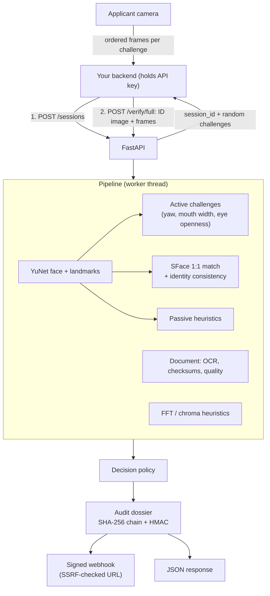

# 🛡️ TrustID: Video KYC Verification API

[](https://github.com/saravanan-22/trustid-vkyc-service/actions/workflows/tests.yml)
[](https://www.python.org/downloads/)
[](https://fastapi.tiangolo.com)
[](LICENSE)

A REST service that runs a Video KYC flow: ID document checks, randomized
active-liveness challenges, 1:1 face matching between the ID portrait and live
frames, and a signed, hash-chained audit trail for every decision.

> **Status: reference implementation.** It shows how the pieces of a VKYC
> pipeline fit together and uses real face models, but it has not been
> benchmarked on a representative dataset, certified (ISO/IEC 30107-3 PAD,
> iBeta, etc.) or reviewed for any regulator's requirements. Don't use it to
> make real identity decisions without that work.

---

## What each check actually does

| Check | How it works | Strength |
|---|---|---|
| Face detection | **YuNet** CNN (OpenCV Model Zoo), with five landmarks | Real model |
| 1:1 face match | **SFace** 128-D embeddings, cosine similarity, threshold 0.363 (the model's published LFW threshold) | Real model; tune the threshold on your own data |
| Active liveness | Randomized challenges (turn left/right, blink, smile) checked from landmarks **across frames**. Each one needs measurable movement, so a still photo can't pass | Heuristic on real landmarks |
| Identity consistency | Embeddings of sampled frames must match the primary frame, so swapping people mid-capture fails | Real model |
| Passive liveness | Blur, glare and skin-chroma heuristics on the detected face | Weak heuristic; not a PAD model |
| Synthetic media / virtual camera | 2D FFT spectral statistics and chroma-noise heuristics | Weak heuristic; **can only send a case to review, never approve it** |
| Document text | Server-side **Tesseract** OCR when installed, otherwise text supplied by the API client. Missing text is flagged, never invented | Real OCR |
| Document numbers | Aadhaar **Verhoeff** checksum, PAN structure, passport **ICAO 9303 MRZ** check digits and expiry | Deterministic |
| Audit trail | SHA-256 over the canonical JSON of the whole dossier, chained to the previous record, HMAC-signed, and re-verified on every read | Deterministic |

### Decision policy (`app/services/verification_pipeline.py`)

- **REJECTED** if any hard check fails: no face, more than one face, face
  mismatch, identity changes between frames, any active challenge fails, or
  passive liveness fails.
- **REVIEW_REQUIRED** if no hard check failed but a soft signal fired: document
  checks failed, or a synthetic-media / virtual-camera heuristic flagged.
- **APPROVED** only when every check passes.

Every dossier records the `rejection_reasons`, the `review_reasons` and the
`policy_version`.

---

## Architecture



---

## Quickstart

### 1. Install

```bash
git clone https://github.com/saravanan-22/trustid-vkyc-service.git
cd trustid-vkyc-service
python3 -m venv .venv && source .venv/bin/activate
pip install -r requirements-dev.txt

# Face models (YuNet ~0.2 MB, SFace ~37 MB), checksum-verified
python scripts/download_models.py
```

Optional: install Tesseract (`sudo apt install tesseract-ocr`) for server-side OCR.

### 2. Configure secrets

The service won't start without real secrets, and it rejects the old public
demo values.

```bash
cp .env.example .env
python -c "import secrets; print(secrets.token_urlsafe(48))"   # run once per value
```

Fill in `TRUSTID_API_KEYS`, `AUDIT_SIGNING_SECRET` and `WEBHOOK_SIGNING_SECRET`
(the two signing secrets must be different).

### 3. Run

```bash
uvicorn app.main:app --host 127.0.0.1 --port 8000
```

- Demo portal: http://127.0.0.1:8000/ (paste an API key, connect the camera, and follow the prompts)
- Swagger: http://127.0.0.1:8000/docs
- Health: http://127.0.0.1:8000/health (returns 503 if the face models aren't loaded)

### 4. Docker

```bash
cp .env.example .env   # and fill it in
docker compose up --build
```

The image installs Tesseract and downloads the models at build time. Compose
runs two workers with Redis as the shared session store. A single container
without `REDIS_URL` runs one worker.

### 5. Tests

```bash
pytest -v
```

The suite covers the decision policy, every liveness rule, checksum
validation, audit tampering and chain breaks, SSRF protection, webhook
signatures, upload limits, session isolation and expiry, plus end-to-end API
runs. Face-matching tests use public-domain NASA portraits
(`tests/fixtures/faces/SOURCES.md`). They check that two different photos of
the same person match, that different people don't, and that noise and
cartoons aren't detected as faces.

---

## Using the API

### Python SDK

```python
from client_sdk.trustid import TrustIDClient

client = TrustIDClient(base_url="http://localhost:8000")  # reads TRUSTID_API_KEY

session = client.create_session(user_id="customer_8941", document_type="AADHAAR")
# Show session["challenges"] to the applicant and capture ordered frames:
# a few neutral frontal frames first, then a burst of frames per challenge.

result = client.verify_full(
    session_id=session["session_id"],
    id_document_path="id_card.jpg",
    live_frame_paths=frame_paths,              # e.g. 20 ordered JPEGs
    callback_url="https://api.example.com/webhooks/kyc",
)
print(result["verdict"], result["dossier"]["rejection_reasons"], result["dossier"]["review_reasons"])
```

### Verifying webhooks

Callbacks carry `X-TrustID-Timestamp` and `X-TrustID-Signature`, an
HMAC-SHA256 of `"<timestamp>.<raw body>"` made with `WEBHOOK_SIGNING_SECRET`:

```python
from client_sdk.trustid import verify_webhook_signature

ok = verify_webhook_signature(raw_body, headers["X-TrustID-Timestamp"],
                              headers["X-TrustID-Signature"], WEBHOOK_SIGNING_SECRET)
```

Old timestamps (more than 5 minutes by default) are rejected to prevent replays.

### Postman / Bruno

Collections live in `postman/` and `bruno/`. Set `apiKey` to one of your keys.
The **Execute Full VKYC** request sends a single still photo, so its expected
verdict is `REJECTED` (`ACTIVE_LIVENESS_FAILED`). That shows liveness is
enforced. A real run needs the frame sequence from the demo portal.

---

## Security model

- **API keys:** several keys are supported (for rotation) and compared in
  constant time. Sessions and audit dossiers are scoped to the key that created
  them, and other keys get `404`.
- **Sessions:** IDs are random, sessions are single-use (an atomic claim
  prevents double submission), they expire after `SESSION_EXPIRY_SECONDS`
  (`410`), and finished sessions can't be reused (`409`).
- **Uploads:** the request body, size per image, pixel count (checked from the
  header, which blocks decompression bombs) and number of frames are all
  limited. CPU-heavy work runs off the event loop.
- **Webhooks:** HTTPS only. URLs that resolve to private, loopback,
  link-local or metadata addresses are refused, both when the request comes in
  and again before every delivery. Redirects aren't followed. The signing
  secret is separate from the audit secret.
- **Audit:** editing any field of a stored dossier, re-hashing it without the
  secret, or deleting a record from the chain is detected
  (`AuditService.verify_chain()`).
- **CORS:** off by default (the demo portal is same-origin).

---

## Known limitations and next steps

- **Passive liveness and deepfake detection are heuristics.** Replace them
  with trained, benchmarked PAD and deepfake models, and measure APCER/BPCER on
  real attack data.
- **Blink and smile detection** use five landmarks and eye-patch contrast.
  A dense landmark model (e.g. MediaPipe Face Mesh with eye aspect ratio)
  would be more robust. Blinks are short, so the client has to capture frames
  frequently (the demo uses ~180 ms intervals).
- **The face-match threshold** is the model's published value. Calibrate it
  on your own population and capture conditions.
- **Audit storage** is JSON files with a file lock, which suits a single host.
  Use an append-only database table or WORM storage across hosts.
- **Spoken verification code:** the code is shown but not checked (that would
  need audio or lip-sync analysis), so it's never used as a challenge.
- **Webhook delivery** uses in-process background tasks with retries. Use a
  durable queue for guaranteed delivery.

---

## Project layout

```
app/
  api/v1/endpoints/   sessions, verify, liveness, face match, document, audit
  core/               config (secrets validation), security, upload limits, SSRF checks
  services/           face_engine (YuNet/SFace), liveness, face_matcher, ocr,
                      deepfake heuristics, verification_pipeline (policy), audit,
                      session_store (memory/Redis), webhooks
client_sdk/           Python client + webhook verification helper
scripts/              download_models.py, generate_sample_assets.py
static/               demo portal
tests/                pytest suite + public-domain face fixtures
```

## Third-party models and data

- YuNet face detector: [OpenCV Model Zoo](https://github.com/opencv/opencv_zoo), MIT licence.
- SFace face recognizer: [OpenCV Model Zoo](https://github.com/opencv/opencv_zoo), Apache-2.0 licence.
- Test and sample portraits: NASA, public domain (see `tests/fixtures/faces/SOURCES.md`).
  The sample ID card is a clearly marked SPECIMEN with fictional details.

## License

MIT, see [LICENSE](LICENSE).
